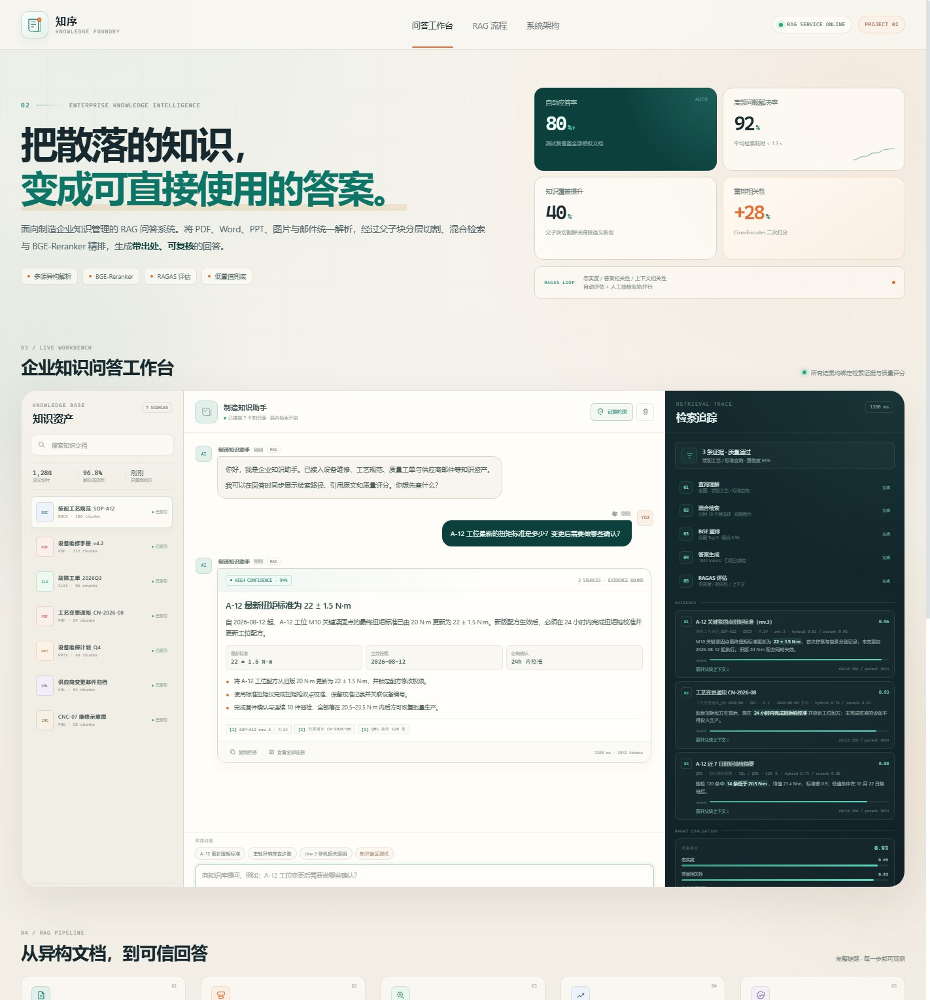

# 知序 · 企业 RAG 智能问答系统 Demo

面向制造企业知识管理的交互式 RAG 问答工作台。把散落在 PDF、Word、PPT、图片和邮件中的知识统一接入，经过父子块分层切割、混合检索、BGE-Reranker 精排与 RAGAS 质量评估，输出带出处、可复核的答案。

> 在线体验：**https://carrotrain4.github.io/rag-knowledge-demo/**
>
> 本页面为可交互前端原型。检索、重排、生成与 RAGAS 评分由浏览器内状态机模拟；生产版本可接入真实 RAG 服务。所有企业与业务数据均为虚构演示数据。



## 可以在页面里体验什么

- **3 个制造业务问答场景**
  - A-12 工位最新扭矩标准与变更确认
  - CNC-07 主轴异响排查与验收阈值
  - Line 2 近 7 日停机损失与原因分析
- **检索过程可视化**
  - 查询理解 → 混合检索 → BGE 精排 → 答案生成 → RAGAS 评估
  - 每一步展示阶段状态、证据数量与运行耗时
- **证据追溯**
  - 右侧展示 Top-3 语义块、父子块上下文、重排相关性
  - 点击引用可查看文档位置、原文片段与 rerank 得分
- **RAGAS 质量面板**
  - 忠实度、答案相关性、上下文相关性三维评分
  - 正常回答与低置信兜底采用不同质量状态
- **低置信兜底**
  - 点击「知识盲区测试」，触发联网搜索与问题回流队列
  - 明确标注内部知识不足，不把无依据内容包装成确定答案
- **多源文档接入**
  - 左侧知识资产可搜索、查看文档详情
  - 「接入新文档」可实际选择本地文件，模拟解析 → 切片 → 向量化 → 已索引流程
- **回答交付**
  - 复制回答内容
  - 展开父块上下文
  - 一键查看引用证据

## 设计要点

| 能力 | Demo 中的表现 | 对应方案 |
| --- | --- | --- |
| 父子块分层切割 | 子块命中高亮，父块上下文可展开 | 256 字符子块 + 1,024 字符父块 |
| 混合检索 | 展示 BM25 + Vector 双路融合 | 关键词召回 + 语义召回 |
| BGE-Reranker | 每个证据展示 rerank 相关性 | CrossEncoder 二次排序 |
| 证据约束 | 回答绑定来源与页码/文档位置 | 引用式生成 |
| RAGAS 评估 | 三维评分条与综合分 | 忠实度 / 答案相关性 / 上下文相关性 |
| 低置信兜底 | 错误答案场景触发联网和回流 | 阈值 + Web Search + 问题队列 |
| 多源接入 | 上传文件后模拟切分与索引 | 多格式解析与向量化 |

## 本地运行

```bash
python -m http.server 8000
```

访问 `http://localhost:8000/`。页面无需构建步骤，也没有第三方前端依赖。

## 文件结构

```text
.
├── index.html          # 工作台、流程与架构展示
├── styles.css          # 响应式视觉系统与动效
├── app.js              # 问答状态机、检索证据与上传交互
├── favicon.svg
├── preview.jpg
├── .nojekyll
└── README.md
```

## 实现边界

本 Demo 强调**产品交互与 RAG 可解释性**，方便面试现场直接打开演示：

- 内置三套制造业务问答与一套低置信问答模板；
- 文档解析、混合检索、重排与 RAGAS 分数为前端模拟；
- 上传功能会模拟解析与索引，不将文件发送到服务器；
- 生产版本可将页面的检索事件协议接入 `FastAPI + LangChain/LangGraph + Qdrant + BGE + RAGAS` 服务。

---

AI 应用开发作品集 · Project 02 · 2026
